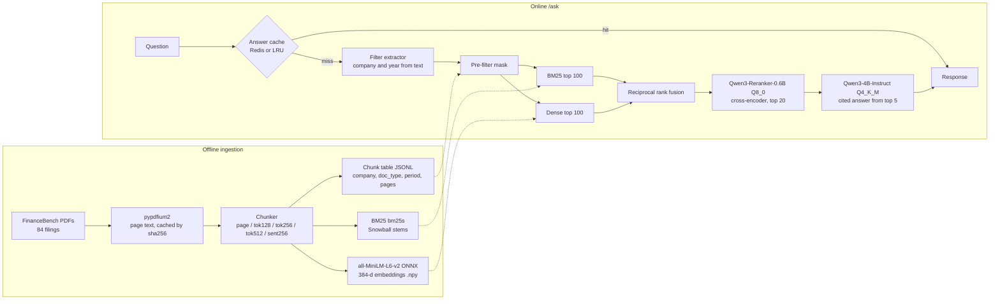

# rag-eval-system

[](https://github.com/Samarateja0118/rag-eval-system/actions/workflows/ci.yml)

A retrieval-augmented generation (RAG) system over **real SEC filings**, built to be measured. It covers ingestion,
hybrid search (BM25 + dense embeddings), metadata filters, a cross-encoder reranker, a cache, a local LLM
generator, and an eval harness that scores retrieval (Recall@k, MRR) and generation (faithfulness, correctness).
Everything runs on CPU, with open weights and no paid API.

All numbers below come from running this repo on a 4-core x86 VM (Intel Xeon 2.1 GHz, AVX-512, no GPU, 15 GB RAM).
Raw per-question outputs are in [`results/`](results/).

**At a glance** (150 FinanceBench questions over 84 real filings, CPU only; details and confidence intervals in [Results](#results)):

- Hybrid BM25 + dense retrieval with a Qwen3 cross-encoder reranker: **Recall@5 0.540, MRR@10 0.416**, up from 0.340 / 0.261 for hybrid search alone.
- Hybrid beats BM25 alone by +0.084 MRR@10 (95% CI [+0.042, +0.126]); its edge over dense-only is not statistically significant.
- Generation with a 4B local model: 36.7% of answers correct, 78.3% of cited numbers found verbatim in the retrieved passages.
- Biggest failure, measured: 28% of top-1 results come from the wrong filing of the right company.

## Corpus and labels

[FinanceBench](https://github.com/patronus-ai/financebench) (Islam et al., 2023), open-source subset:

- **150 analyst-written questions** about public companies. Each has a gold answer and **page-level evidence**
  (filing + PDF page).
- **84 filings** referenced by those questions (10-K, 10-Q, 8-K, earnings releases from 32 companies,
  2015 to 2024). That comes to **12,013 PDF pages**.
- Metadata per filing: company, GICS sector, document type, fiscal period. These are the filter fields.

A retrieved chunk counts as relevant when it comes from the evidence filing and its page span contains the
evidence page. I checked our page numbering against the labels by fuzzy-matching each evidence snippet to the
extracted pages: 187 of 189 evidence items land on exactly the labelled page.

## Architecture



| Component | Choice | Why |
|---|---|---|
| PDF text | pypdfium2 | Fast, permissive license, gets page boundaries right (verified above) |
| Embeddings | all-MiniLM-L6-v2, ONNX Runtime | Small enough to embed 37k-75k chunks on CPU in 6-16 min |
| Lexical | bm25s, k1=1.2, b=0.75, stemmed, stopwords removed | Exact numbers and names matter in filings |
| Vector search | Exact dot product over a float32 matrix | At 37k x 384 it takes a few ms, so ANN recall loss is not worth it |
| Filters | Boolean mask applied **before** top-k | A filtered query still gets k results from the allowed subset |
| Fusion | RRF (c=60), plus min-max weighted fusion as an ablation | No score calibration needed |
| Reranker | Qwen3-Reranker-0.6B via llama.cpp (`pooling=rank`) | Open weights, runs on CPU; quantized F16 to Q8_0 for 2x speed |
| Generator | Qwen3-4B-Instruct-2507 Q4_K_M via llama.cpp, temperature 0 | Largest model that answers in under a minute on 4 cores |
| Cache | Redis (Compose) or in-process LRU; JSON values | Keys include the index fingerprint and pipeline config, so a rebuild cannot serve stale answers |

## Results

### 1. Chunking x retriever (auto company filter, all 150 questions)

| Chunking | Chunks | BM25 R@5 | Dense R@5 | Hybrid R@5 | Hybrid R@10 | Hybrid MRR@10 | Context tokens in top 5 |
|---|---|---|---|---|---|---|---|
| page (1 PDF page) | 11,948 | 0.197 | 0.327 | 0.327 | 0.480 | 0.229 | 3,531 |
| tok128 (overlap 16) | 75,483 | 0.207 | 0.306 | 0.314 | 0.474 | 0.232 | 636 |
| **tok256 (overlap 32)** | 37,514 | 0.193 | 0.321 | **0.340** | **0.503** | **0.261** | 1,273 |
| tok512 (overlap 64) | 18,746 | 0.233 | 0.342 | 0.320 | 0.447 | 0.246 | 2,555 |
| sent256 (sentence-packed) | 45,418 | 0.203 | 0.303 | 0.293 | 0.407 | 0.204 | 1,057 |

tok256 gave the best hybrid MRR@10 and is used for everything below. Larger chunks cover more pages per hit,
so their recall is inflated per unit of context (see the token column). tok256 matches page-level recall with
about a third of the context. Sentence packing did worst: SEC tables have no sentence punctuation, so sentence
splits fall in odd places.

### 2. Retriever and metadata filters (tok256)

| Filter | BM25 MRR@10 | Dense MRR@10 | Hybrid MRR@10 | Hybrid R@5 | Hybrid R@20 | Top-5 has right filing |
|---|---|---|---|---|---|---|
| none | 0.126 | 0.204 | 0.214 | 0.303 | 0.568 | 0.787 |
| auto: company | 0.177 | 0.217 | 0.261 | 0.340 | 0.647 | 0.873 |
| auto: company + year (+/-1) | 0.206 | 0.264 | 0.301 | 0.393 | 0.691 | 0.907 |
| oracle: gold filing | 0.288 | 0.361 | 0.425 | 0.584 | 0.803 | 1.000 |

The automatic extractor finds the right company in 147 of 150 questions (alias table plus regex; the 3 misses
never name the company). The oracle row is an upper bound for filtering, not something a user gets.

### 3. Fusion and reranking (tok256, auto company filter)

| Pipeline | R@1 | R@5 | R@10 | MRR@10 |
|---|---|---|---|---|
| BM25 only | 0.120 | 0.193 | 0.303 | 0.177 |
| Dense only | 0.110 | 0.321 | 0.521 | 0.217 |
| Weighted fusion, alpha=0.3 / 0.5 / 0.7 (dense weight) | 0.130 / 0.147 / 0.137 | 0.257 / 0.307 / 0.363 | 0.387 / 0.440 / 0.494 | 0.211 / 0.240 / 0.252 |
| Hybrid RRF | 0.140 | 0.340 | 0.503 | 0.261 |
| **Hybrid RRF + Qwen3 reranker (top 20)** | **0.280** | **0.540** | **0.607** | **0.416** |

Paired bootstrap over questions (10,000 resamples), 95% CI for the difference:

| Comparison | dMRR@10 | dRecall@5 |
|---|---|---|
| Hybrid vs BM25 | +0.084 [+0.042, +0.126] | +0.147 [+0.077, +0.217] |
| Hybrid vs dense | +0.044 [-0.001, +0.088] | +0.019 [-0.054, +0.094] |
| Company filter vs none (hybrid) | +0.046 [+0.020, +0.075] | +0.037 [-0.003, +0.080] |
| Reranker vs hybrid | **+0.155 [+0.095, +0.216]** | **+0.200 [+0.127, +0.273]** |

The reranker is the largest single gain. Hybrid clearly beats BM25. Its edge over dense-only is **not**
statistically clear at n=150, because the CI touches zero.

### 4. Generation (all 150 questions)

Pipeline: tok256 chunks, hybrid RRF plus auto company filter, reranked top 20, **top 5 passages** go to
Qwen3-4B-Instruct-2507 (Q4_K_M, temperature 0). It is told to cite passages and to say
`INSUFFICIENT CONTEXT` when it can't answer. The judges are the same model with JSON-schema-constrained output.

| Metric | Value | How it is computed |
|---|---|---|
| Correct | **36.7%** (55/150) | LLM judge vs FinanceBench gold answer (rounding and unit differences allowed) |
| Incorrect | 35.3% (53/150) | |
| Abstained | 28.0% (42/150) | judge verdict; 43% of answers contain the abstain phrase somewhere, often after a partial answer |
| Gold evidence page in the 5 passages | 58.0% | page-level labels, no LLM |
| Correct when evidence page in context / not | 46.0% / 23.8% | the second number is answers built from other pages that restate the figure |
| Faithfulness, claim level | 0.695 (85 answers judged, abstentions skipped) | judge splits the answer into claims and marks each supported or not by the passages |
| Answers with every claim supported | 41.2% | |
| Numeric grounding | 78.3% of 263 numbers | deterministic: numbers in the answer (3+ digits, not years) found verbatim in the passages |
| Correct by question type | domain-relevant 44%, novel 40%, metrics 26% | metrics questions need multi-line arithmetic over statements |

Judge reliability, checked by hand ([`results/generation_spotcheck.md`](results/generation_spotcheck.md)):
- The **correctness** judge agreed with my reading on 15 of 16 sampled verdicts. The one exception was a
  strict call on a "Yes" answer that matched the gold conclusion.
- The **faithfulness** judge is weaker. In the first 30 answers it disagreed with the verbatim number check on
  10 of 22 number-bearing claims. On reading the passages, it wrongly rejected 4 numbers that were in a table
  and wrongly accepted 1 set of made-up numbers. Read the 0.695 as a noisy, probably low estimate. The numeric
  grounding rate is the more trustworthy companion number.

For context only, not a like-for-like comparison: the FinanceBench paper (Islam et al., 2023) reports that
GPT-4-Turbo with a shared vector store got 19% of these questions right. Its setup, corpus size (all 361
filings) and grading (human) differ from this repo's.

### 5. Latency and cost

Single request at a time, 4 cores, idle VM ([`results/latency_cost.json`](results/latency_cost.json)).
Produced by `scripts/latency_report.py`.

| Stage / path | p50 | p95 | n |
|---|---|---|---|
| Query embedding (MiniLM ONNX, cold) | 14 ms | | 150 |
| BM25 + dense + RRF with filter mask (37.5k chunks) | 6.6 ms | 13 ms | 150 |
| **Search, cold** (filter extraction + embed + retrieve) | **23 ms** | 33 ms | 150 |
| Rerank top 20 (Qwen3-Reranker-0.6B Q8_0, ~8k tokens) | 29.4 s | 33.2 s | 20 |
| Generate (Qwen3-4B Q4_K_M, ~1,770 prompt + ~90 output tokens) | 35.9 s | 45.2 s | 150 |
| **Full /ask, answer-cache miss** | **58.0 s** | max 61.1 s | 5 |
| **Full /ask, answer-cache hit (Redis)** | **0.36 ms** | max 0.42 ms | 5 |

Cost, assuming the whole 4-vCPU VM costs **$0.17/hour** (an assumed on-demand price, not a bill; pass
`--usd-per-hour` for yours) and serves one request at a time:

| Path | $ per 1,000 requests |
|---|---|
| Search only | $0.001 |
| Search + rerank | $1.39 |
| Full /ask (miss) | $2.74 |
| Full /ask (cache hit) | under $0.0001 |
| One-time indexing of the corpus (tok256: 2.5 min PDF extraction + 13.9 min embedding/BM25) | about $0.05 total |

Where the time goes: on CPU, the **two LLM stages are about 99.9% of latency.** Retrieval is cheap. The
reranker costs as much as generation, and it buys the largest quality gain in this repo (MRR +0.155). That
makes the obvious levers a GPU, reranking 10 instead of 20 candidates, or a smaller cross-encoder. None of
them were measured here. For repeated questions (dashboards, FAQ-style traffic), the answer cache turns a
58-second request into a sub-millisecond Redis read. The cache key includes the index fingerprint and
pipeline config, so a re-index invalidates it automatically.

## Failure cases

1. **Wrong filing, right company (the biggest problem).** After reranking, **42 of 150 top-1 results (28%)**
   come from another filing of the right company, such as 3M's 2022 10-K instead of the 2023 10-Q. Every
   filing restates similar line items, so text alone can't tell them apart. The year-aware filter helps
   (MRR 0.261 to 0.301). The oracle filter shows the ceiling (0.425 before reranking).
2. **Vocabulary gap between analyst questions and statement tables.** "What is the FY2018 capital expenditure
   amount for 3M?" is answered on the cash-flow page by the line "Purchases of property, plant and equipment
   (PP&E)". BM25 never ranks that page in the top 10. Dense ranks it 3rd, but RRF drops it out of the top 10
   because BM25 votes for other pages ([`scripts/smoke.py`](scripts/smoke.py) runs exactly this case in CI).
   Ratio questions ("quick ratio", "fixed asset turnover") have the same problem: the answer is a balance
   sheet that never says "ratio".
3. **Candidate generation caps the reranker.** 46 of 150 questions have no evidence page in the top 20 the
   reranker sees. The reranker can only reorder, so Recall@20 (0.647) stays the same before and after. Half of
   those misses (23) are found when the oracle filing filter is applied, so most of them are failure case 1.
4. **Multi-page evidence.** The 35 questions whose evidence spans 2 to 3 pages (e.g. income statement plus
   balance sheet) reach R@5 0.457 vs 0.540 overall.
5. **Encoder truncation.** all-MiniLM-L6-v2 reads 256 word pieces. A tok256 chunk plus its "Company DOC year."
   header goes a few tokens past that for 88% of chunks, so their last ~10 tokens are not embedded (BM25
   still indexes them). tok512 loses half of every chunk, and page chunks lose most of the page, which is
   part of why their dense numbers are not better despite more text.

Generation-side failures (from `results/generation/answers.jsonl`):

6. **Arithmetic on the wrong line items.** Metrics questions score lowest (26%). Examples: J&J's Q2 net margin was
   computed from the wrong lines (14.6% vs gold 20.1%). Lockheed's 2-year revenue CAGR used the right formula
   and inputs but got the arithmetic wrong (0.9% vs gold 0.4%). And
   Kraft Heinz's inventory turnover was abstained because the prior-year inventory sat in a passage that wasn't
   retrieved.
7. **Made-up inputs dressed up as arithmetic.** For AES ROA the model wrote "(7,575 + 7,525)/2", and neither
   number appears in any passage. For General Mills it backed "current liabilities" out of an unrelated cash-flow line. The faithfulness judge
   accepted the AES case, which is exactly the failure a weak judge lets through.
8. **Right facts, wrong direction.** For 3M it wrote "PP&E $9,178M in 2022, up from $9,429M", which is a fall,
   and concluded "capital-intensive" when the gold answer says no.

## What was and was not measured

Measured:
- Every retrieval number above, on all 150 questions, with per-question rows in `results/retrieval/`.
- Generation answers, judge outputs and timings for every question in `results/generation/answers.jsonl`.
- Latency on the hardware stated at the top, with one request at a time.

Not measured, or weaker than it looks:
- **No held-out split.** 150 questions are too few to hold some out. I picked the chunking (tok256) and
  pipeline from the same questions I report on, so the best-config numbers are optimistic.
- **The judge is a small local model, and it is the same model as the generator** (Qwen3-4B-Instruct).
  Faithfulness and correctness are LLM-judged with JSON-schema-constrained output. Same-model judging can be
  lenient toward its own answers. I hand-checked a sample (see the generation section). These are not human
  labels.
- **Reranking was run once**, on the best configuration (tok256, auto company filter). Its effect on the other
  chunkings and filters was not measured, because each run takes about 85 minutes of CPU.
- **No concurrency or throughput testing.** Latency is single-request on an otherwise idle VM. The API has no
  load test.
- **Cost is computed from wall-clock time and an assumed VM price** (`--usd-per-hour`, default $0.17 for a
  4-vCPU on-demand VM). It is not a cloud bill. Prices vary by provider and region.
- **Docker:** the image is built in GitHub Actions CI. The development VM could not build it, because
  container builds there had no network. All measured numbers came from a Python 3.11 venv on the VM plus a
  Redis 7.4 container, not from the full Compose stack. The API itself was exercised locally (`/healthz`,
  filtered `/search`, filter validation, `/stats`).
- Only the 84 filings the questions reference are indexed, not all 361 FinanceBench filings, so there are
  fewer distractor documents than a production corpus would have.

## Running it

```bash
# local (Python 3.11)
pip install -e ".[llm,dev]"
bash scripts/fetch_models.sh            # ~4.3 GB: MiniLM ONNX + Qwen3 reranker + Qwen3-4B (sha256-pinned)
python -m ragsys.cli fetch              # FinanceBench metadata + 84 PDFs (159 MB)
python -m ragsys.cli build              # all 5 chunk configs (~55 min on 4 cores); --config tok256 for one
python -m ragsys.cli eval-retrieval     # ~5 min, plus ~85 min for the reranker run (--quick skips it)
python -m ragsys.cli eval-generation    # ~80 s/question; reuses the reranked top-5 lists from eval-retrieval
python scripts/latency_report.py
python -m ragsys.cli ask "What was Adobe's FY2022 operating margin?"

# Docker Compose
docker compose run --rm models && docker compose run --rm ingest
docker compose up -d redis api
curl -s localhost:8000/ask -H 'content-type: application/json' \
  -d '{"question": "What is the FY2018 capital expenditure amount for 3M?"}'
curl -s localhost:8000/search -H 'content-type: application/json' \
  -d '{"query": "quick ratio", "filters": {"company": "AMD", "doc_period": 2022}, "k": 5}'
```

API: `POST /search` (query, k, filters, rerank), `POST /ask` (question, filters, use_cache), `GET /healthz`,
`GET /stats` (cache hits/misses). Filter fields: `doc_name`, `company`, `gics_sector`, `doc_type`, `doc_period`.

CI ([`.github/workflows/ci.yml`](.github/workflows/ci.yml)) runs ruff, 16 unit tests (chunking, filters
applied before top-k, RRF, page-level metrics, bootstrap, cache, filter extraction), a smoke test on one real
filing with the real ONNX embedder, and a Docker image build.

## Layout

```
ragsys/
  ingest/pdf.py, chunking.py, pipeline.py   fetch, extract, chunk, embed, index (idempotent via fingerprint)
  embed.py        MiniLM ONNX encoder         store.py     index on disk + metadata masks
  retrieve.py     BM25, dense, RRF, weighted   filters.py   question -> company/year filters
  rerank.py       Qwen3 cross-encoder          generate.py  cited answers from a local LLM
  cache.py        Redis / LRU                  service.py   the online pipeline with stage timers
  api.py          FastAPI                      eval/        metrics, retrieval and generation runners
scripts/          fetch_models.sh, pull_model.py, quantize.py, latency_report.py, smoke.py
results/          retrieval_summary.md, retrieval/*.json, generation/, latency_cost.json
```

## Licenses

Code: MIT. FinanceBench data: CC BY-NC 4.0 (Patronus AI), downloaded at run time and not redistributed here.
Model weights are downloaded at run time under their own licenses (all-MiniLM-L6-v2: Apache-2.0; Qwen3: Apache-2.0).
